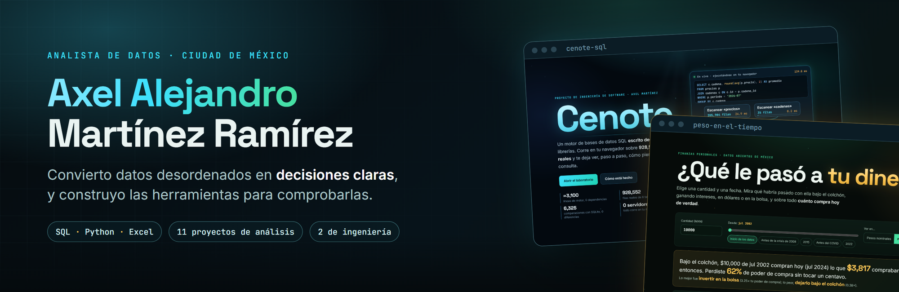
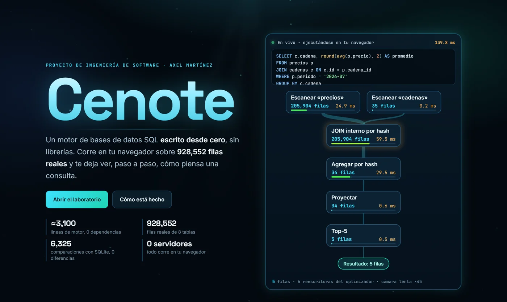
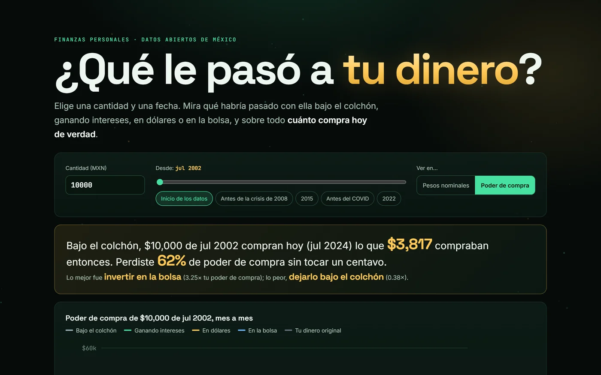
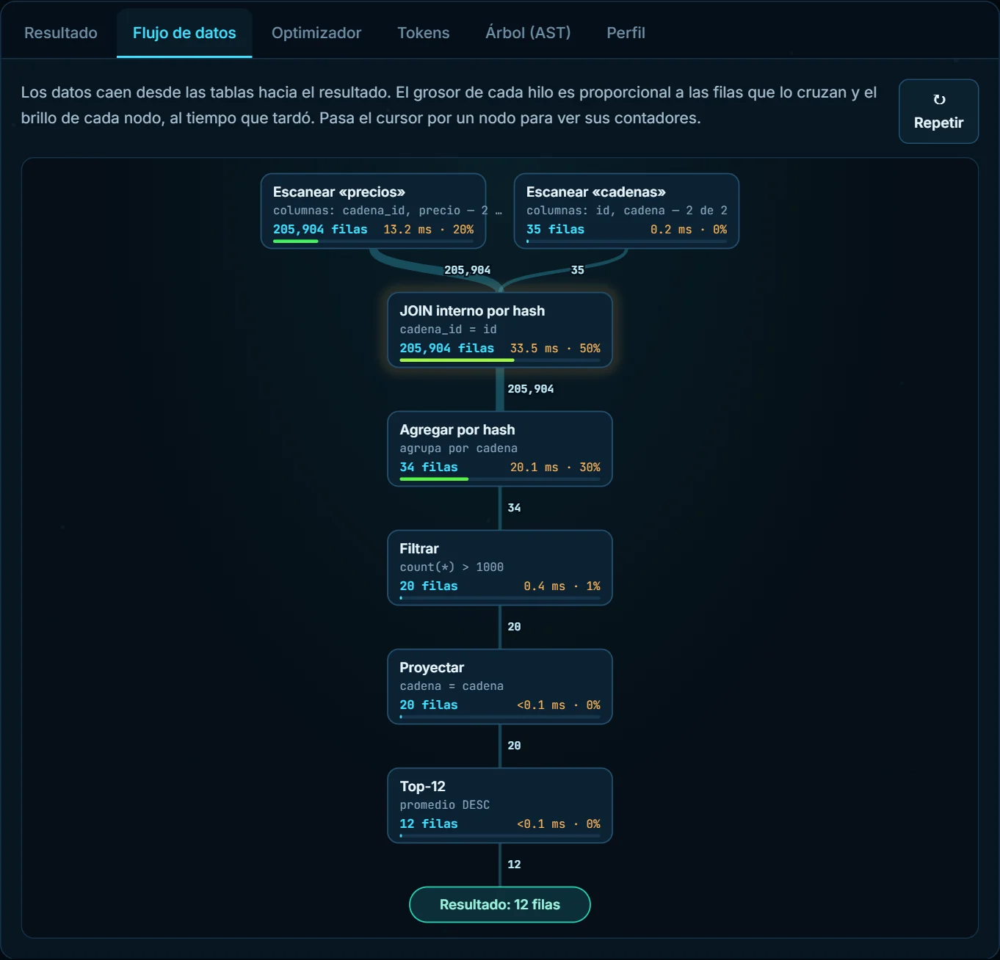
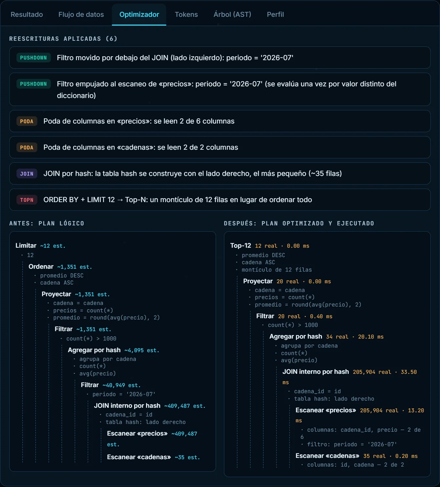
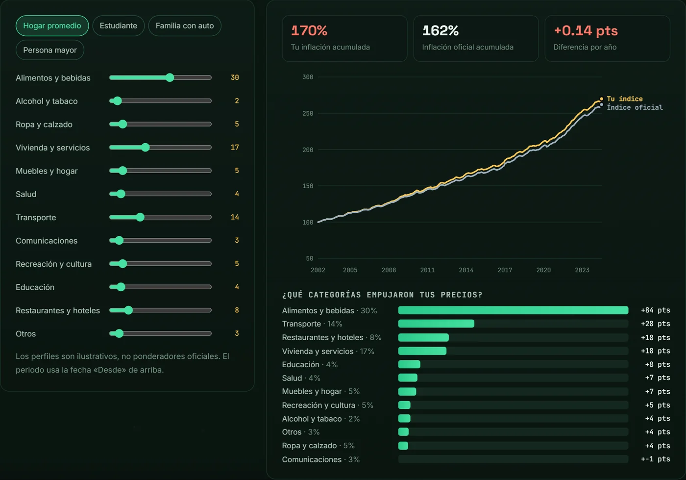
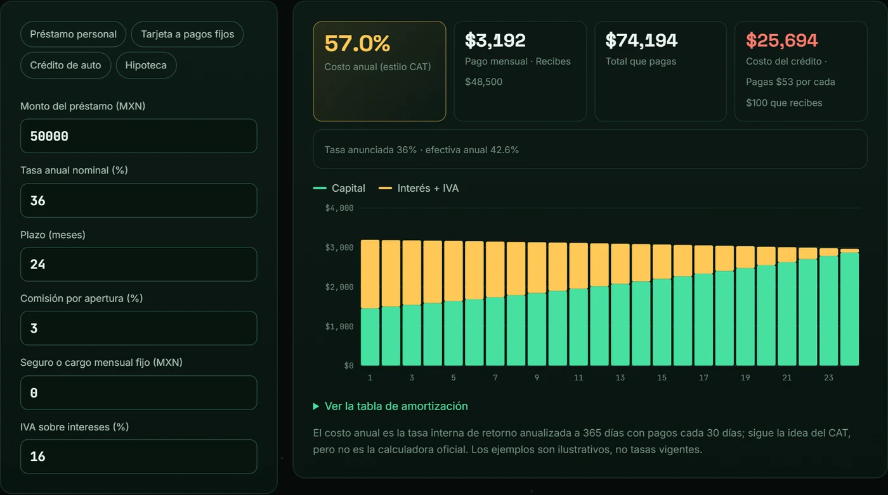
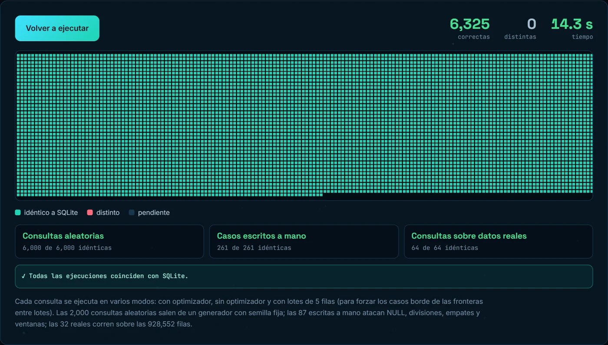
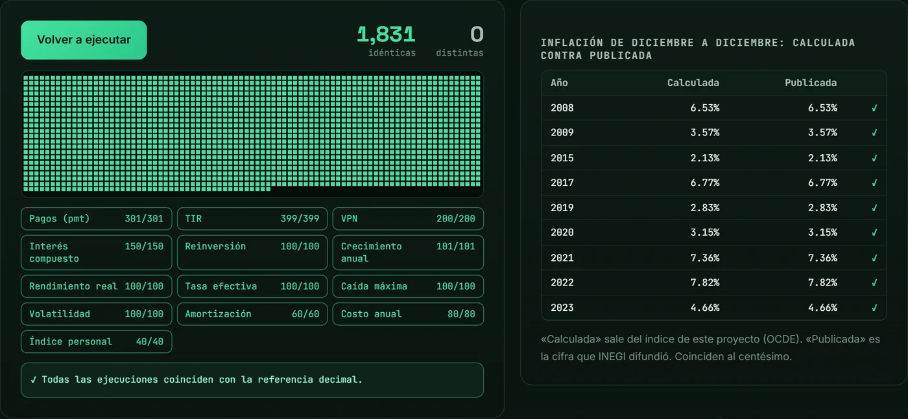

  

  <a href="https://martinezramirezaxelalejandro04-ui.github.io/"><b>Sitio web</b></a> &nbsp;·&nbsp;
  <a href="https://martinezramirezaxelalejandro04-ui.github.io/skyline/">Skyline 3D</a> &nbsp;·&nbsp;
  <a href="https://martinezramirezaxelalejandro04-ui.github.io/cenote-sql/">Cenote</a> &nbsp;·&nbsp;
  <a href="https://martinezramirezaxelalejandro04-ui.github.io/peso-en-el-tiempo/">Mi peso en el tiempo</a> &nbsp;·&nbsp;
  <a href="https://www.linkedin.com/in/mart%C3%ADnez-ram%C3%ADrez-axel-alejandro-5ba156251">LinkedIn</a> &nbsp;·&nbsp;
  <a href="mailto:martinez.ramirez.axel.alejandro04@gmail.com">Correo</a>

Hola, soy Axel. Me dedico a convertir datos desordenados en respuestas claras para que las personas y los equipos decidan mejor: extracción, limpieza, SQL y visualización. Me importa que cada cifra se pueda explicar y comprobar.

Coyoacán, CDMX · Español nativo, inglés C1 · [LinkedIn](https://www.linkedin.com/in/mart%C3%ADnez-ram%C3%ADrez-axel-alejandro-5ba156251) · [martinez.ramirez.axel.alejandro04@gmail.com](mailto:martinez.ramirez.axel.alejandro04@gmail.com)

*[English version below](#english)*

## Proyectos de ingeniería

Dos proyectos para entender a fondo las herramientas que uso. Los dos funcionan en tu navegador, sin servidor, y comparan sus resultados con una referencia independiente. Los construí con ayuda de IA y documenté el diseño y las pruebas.

<table>
<tr>
<td width="50%" valign="top">

<h3>Cenote</h3>

Un motor de bases de datos SQL que escribí desde cero en JavaScript, sin librerías. Funciona sobre 928,552 filas reales de los proyectos de análisis, muestra cómo se analiza, optimiza y ejecuta cada consulta, y sus resultados coinciden con los de SQLite en <b>6,325 comparaciones</b>.

<a href="https://martinezramirezaxelalejandro04-ui.github.io/cenote-sql/"><b>Abrir la demo</b></a> &nbsp;·&nbsp; <a href="https://github.com/martinezramirezaxelalejandro04-ui/cenote-sql">Código</a>

</td>
<td width="50%" valign="top">

<h3>Mi peso en el tiempo</h3>

Una calculadora que responde «¿qué le pasó a tu dinero?». Indicas una cantidad y una fecha y ves qué fue de ella en México y cuánto compra hoy; además calcula tu inflación personal y el costo real de un crédito. Sus fórmulas coinciden con una referencia decimal (<b>1,831 comparaciones</b>) y su inflación, con la que publicó INEGI.

<a href="https://martinezramirezaxelalejandro04-ui.github.io/peso-en-el-tiempo/"><b>Abrir la calculadora</b></a> &nbsp;·&nbsp; <a href="https://github.com/martinezramirezaxelalejandro04-ui/peso-en-el-tiempo">Código</a>

</td>
</tr>
</table>

  
  

<b>Cenote.</b> A la izquierda, el plan de una consulta como cascada de datos: el grosor de cada hilo son las filas y el color, el tiempo. A la derecha, qué reescribió el optimizador y cómo quedó el plan.

  
  

<b>Mi peso en el tiempo.</b> A la izquierda, tu inflación según en qué gastas frente a la oficial. A la derecha, el costo anual real de un crédito con comisiones e IVA.

  
  

Las comprobaciones se ejecutan en tu navegador: cada cuadro es una ejecución comparada con SQLite (Cenote) o con una referencia decimal (Mi peso en el tiempo).

## Proyectos de análisis en números

| Proyectos de análisis | Registros reales analizados | Pruebas automáticas | Fuentes de datos abiertas |
|:---:|:---:|:---:|:---:|
| **11** | **2.4 millones** | **116** | **6** |

Cada proyecto parte de una pregunta útil para la gente, usa datos abiertos, explica su método y deja a la vista sus limitaciones.

## Marketing y medición

| Proyecto | Pregunta | Hallazgo |
|---|---|---|
| [**Paid Media Kit**](https://github.com/martinezramirezaxelalejandro04-ui/paid-media-kit) | ¿Cómo puede una ONG medir sus anuncios sin pagar una herramienta? | Un proceso que unifica Meta, Google y TikTok Ads en una tabla lista para Looker Studio o Power BI |
| [**Pruebas A/B sin trampas**](https://github.com/martinezramirezaxelalejandro04-ui/pruebas-ab-sin-trampas) | ¿Por qué tantas pruebas A/B "ganadoras" no lo son? | Revisar la prueba cada día sube las falsas alarmas de 5% a 28% |
| [**Vida de una tendencia**](https://github.com/martinezramirezaxelalejandro04-ui/vida-de-una-tendencia) | ¿Cuánto dura un tema en la atención de México? | 58% de las tendencias dura un solo día; al segundo día solo sigue 42% |
| [**Radar de Campañas de Salud**](https://github.com/martinezramirezaxelalejandro04-ui/radar-campanas-salud) | ¿Los días mundiales de salud hacen que la gente busque información? | 76% de las mediciones superó el ruido normal; el efecto casi desaparece en una semana |

## Precios y consumo

| Proyecto | Pregunta | Hallazgo |
|---|---|---|
| [**Canasta Básica MX**](https://github.com/martinezramirezaxelalejandro04-ui/canasta-basica-mx) | ¿Cuánto cambia el precio del mismo producto según dónde lo compras? | El mismo producto de marca cuesta típicamente 20% más en una tienda cara que en una barata |
| [**Farmacias MX**](https://github.com/martinezramirezaxelalejandro04-ui/farmacias-mx) | ¿Y el mismo medicamento? | La misma lista de 20 medicamentos cuesta de $1,040 a $2,268 según la cadena |

## Ciudad, salud y ambiente

| Proyecto | Pregunta | Hallazgo |
|---|---|---|
| [**Choques CDMX**](https://github.com/martinezramirezaxelalejandro04-ui/choques-cdmx) | ¿Cuándo hay más incidentes viales y cuándo son más graves? | El pico es el viernes a las 19:00; de madrugada hay menos choques, pero más con personas lesionadas |
| [**Calor extremo MX**](https://github.com/martinezramirezaxelalejandro04-ui/calor-extremo-mx) | ¿Cuántos días de calor extremo más hay hoy que en los años 80? | La ciudad típica pasó de 12 a 27 días al año |
| [**Aire CDMX**](https://github.com/martinezramirezaxelalejandro04-ui/aire-cdmx) | ¿A qué hora conviene hacer ejercicio al aire libre? | En Ciudad de México las horas menos malas son las 10:00 y las 18:00 |
| [**Lectura fácil en salud**](https://github.com/martinezramirezaxelalejandro04-ui/lectura-facil-salud) | ¿Qué tan difícil de leer es la información de salud en español? | 60 de 66 artículos de salud son difíciles de leer |
| [**¿Tiembla más en septiembre?**](https://github.com/martinezramirezaxelalejandro04-ui/sismos-septiembre) | ¿Septiembre es el mes de los sismos? | El patrón aparece en los últimos 50 años y desaparece en los 76 anteriores |

## Hallazgos destacados

## Cómo trabajo

- **Empiezo por la pregunta.** Cada análisis parte de una decisión que alguien necesita tomar.
- **Documento la limpieza.** Cada paso indica cuántas filas quedan y por qué descarté las demás.
- **Comparo con justicia.** Mismo producto, misma tienda; indicadores sobre totales, no promedios de promedios.
- **Desconfío de los resultados llamativos.** Tres proyectos documentan un error que estuvo a punto de publicarse y cómo lo detecté.
- **Verifico lo que publico.** Código con pruebas automáticas y datos reproducibles.
- **Dejo las limitaciones a la vista.** También escribo lo que los datos no permiten afirmar.

## Herramientas

| | |
|---|---|
| **Uso habitual** | Python (pandas), Excel avanzado |
| **Aplicadas en estos proyectos** | SQL (SQLite, CTE, funciones de ventana), NumPy, matplotlib, pytest, APIs de datos abiertos, pruebas de hipótesis y simulación |
| **Otras** | C++, Scrum (certificado SFC) |

## Sobre mí

- **Formación.** Ingeniería Mecatrónica, Facultad de Ingeniería, UNAM (2022–2026).
- **Experiencia.** Pasante de Logística y Operaciones de Servicio en HONOR México (2025): elaboré reportes de desempeño del proveedor de paquetería, concilié liquidaciones y di seguimiento a las incidencias de principio a fin.
- **Liderazgo.** Jefe de Secretaría General de la Sociedad de Alumnos de Sistemas Biomédicos, UNAM (2025). Líder del equipo que obtuvo el primer lugar en Proyect Ingenious, Facultad de Ingeniería (2023–2024).
- **Certificaciones.** Análisis de Datos con Python (Pandas), Kaggle · Excel: Básico a Intermedio, Santander Open Academy · Fundamentos de Estrategia de Marketing, SCRUMstudy · Scrum Fundamentals Certified, SCRUMstudy.
- **Busco.** Incorporarme como analista de datos, con especial interés en marketing digital y medición de campañas.

Si mi trabajo te resulta útil o quieres platicar, escríbeme a [martinez.ramirez.axel.alejandro04@gmail.com](mailto:martinez.ramirez.axel.alejandro04@gmail.com) o por [LinkedIn](https://www.linkedin.com/in/mart%C3%ADnez-ram%C3%ADrez-axel-alejandro-5ba156251). Con gusto te respondo.

---

## English

**Axel Alejandro Martínez Ramírez** · Data analyst · Mechatronics Engineering, UNAM
Coyoacán, Mexico City · Spanish (native), English (C1) · [Website](https://martinezramirezaxelalejandro04-ui.github.io/) · [3D version](https://martinezramirezaxelalejandro04-ui.github.io/skyline/) · [LinkedIn](https://www.linkedin.com/in/mart%C3%ADnez-ram%C3%ADrez-axel-alejandro-5ba156251)

Hi, I'm Axel. I turn messy data into clear answers so people and teams can decide better: extraction, cleaning, SQL and visualization. Eleven analysis projects, each starting from a question that matters to people, built on open data, with tested code and the limitations in plain sight.

| Project | Finding |
|---|---|
| [Paid Media Kit](https://github.com/martinezramirezaxelalejandro04-ui/paid-media-kit) | A tested pipeline that unifies Meta, Google and TikTok Ads exports into one KPI-ready table |
| [Pruebas A/B sin trampas](https://github.com/martinezramirezaxelalejandro04-ui/pruebas-ab-sin-trampas) | Peeking at an A/B test daily inflates false positives from 5% to 28% |
| [Vida de una tendencia](https://github.com/martinezramirezaxelalejandro04-ui/vida-de-una-tendencia) | 58% of trending topics in Mexico last a single day |
| [Radar de Campañas de Salud](https://github.com/martinezramirezaxelalejandro04-ui/radar-campanas-salud) | 76% of health awareness days beat a placebo test; the lift fades within a week |
| [Canasta Básica MX](https://github.com/martinezramirezaxelalejandro04-ui/canasta-basica-mx) | The same branded grocery product typically costs 20% more in a pricey store (1.46M price records) |
| [Farmacias MX](https://github.com/martinezramirezaxelalejandro04-ui/farmacias-mx) | The same 20 medicines cost from MXN 1,040 to MXN 2,268 depending on the chain |
| [Choques CDMX](https://github.com/martinezramirezaxelalejandro04-ui/choques-cdmx) | Road incidents peak on Fridays at 7 pm; crashes before dawn are fewer but more often cause injuries |
| [Calor extremo MX](https://github.com/martinezramirezaxelalejandro04-ui/calor-extremo-mx) | The typical Mexican city went from 12 to 27 very hot days per year since the 1980s |
| [Aire CDMX](https://github.com/martinezramirezaxelalejandro04-ui/aire-cdmx) | In Mexico City the least-polluted hours for outdoor exercise are around 10 am and 6 pm |
| [Lectura fácil en salud](https://github.com/martinezramirezaxelalejandro04-ui/lectura-facil-salud) | 60 of 66 Spanish health articles are hard to read for the general public |
| [¿Tiembla más en septiembre?](https://github.com/martinezramirezaxelalejandro04-ui/sismos-septiembre) | September's earthquake excess is real in 1976-2025 and absent in 1900-1975 |

**Engineering projects.** Two projects to understand in depth the tools I use. Both run in your browser, with no server, and check their results against an independent reference. I built them with AI assistance and documented the design and tests.

<table>
<tr>
<td width="50%" valign="top">

<h3>Cenote</h3>

A SQL database engine I wrote from scratch in JavaScript with no libraries. It runs over 928,552 real rows from the analysis projects, shows how each query is parsed, optimized and executed, and its results match SQLite's across <b>6,325 comparisons</b>.

<a href="https://martinezramirezaxelalejandro04-ui.github.io/cenote-sql/"><b>Open the demo</b></a> &nbsp;·&nbsp; <a href="https://github.com/martinezramirezaxelalejandro04-ui/cenote-sql">Code</a>

</td>
<td width="50%" valign="top">

<h3>Mi peso en el tiempo</h3>

A calculator that answers "what happened to your money?". Enter an amount and a date and see what became of it in Mexico and how much it buys today, plus your personal inflation and the real cost of a loan. Its formulas match a decimal reference (<b>1,831 comparisons</b>) and its inflation matches INEGI's published figures. Open data up to July 2024; not financial advice.

<a href="https://martinezramirezaxelalejandro04-ui.github.io/peso-en-el-tiempo/"><b>Open the calculator</b></a> &nbsp;·&nbsp; <a href="https://github.com/martinezramirezaxelalejandro04-ui/peso-en-el-tiempo">Code</a>

</td>
</tr>
</table>

**Background.** Mechatronics Engineering at UNAM (2022–2026). Logistics and Service Operations intern at HONOR Mexico (2025), where I prepared carrier performance reports, reconciled settlements and followed incidents from start to finish. Tools: Python (pandas) and advanced Excel; SQL, NumPy and hypothesis testing applied in the projects above.

**Looking for.** A data analyst role, with a special interest in digital marketing and campaign measurement. If my work is useful to you or you'd like to talk, write to me at [martinez.ramirez.axel.alejandro04@gmail.com](mailto:martinez.ramirez.axel.alejandro04@gmail.com) or on [LinkedIn](https://www.linkedin.com/in/mart%C3%ADnez-ram%C3%ADrez-axel-alejandro-5ba156251); I'd be glad to hear from you.
